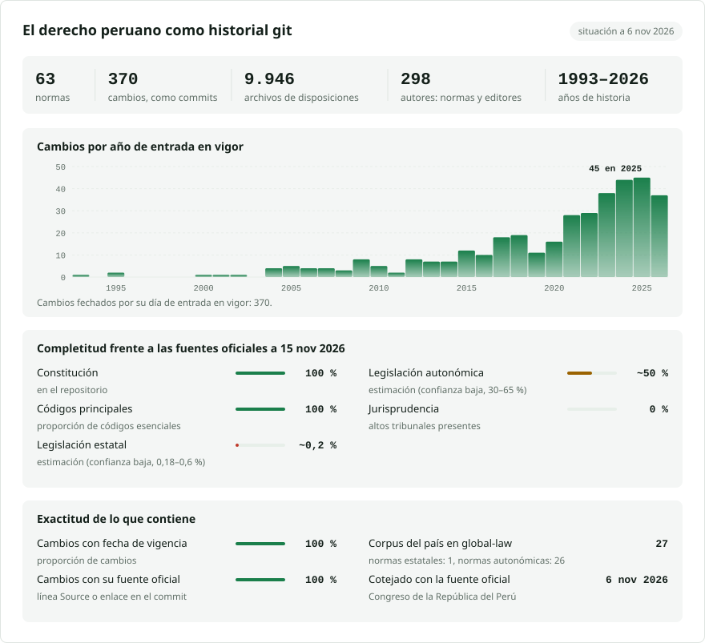

# Perú: historia del derecho en git

**Español** · [English](README.en.md)

<picture>
<source media="(prefers-color-scheme: dark)" srcset="data/es/effort-dark.svg">

</picture>

El derecho del Perú como historial de git: un archivo por disposición, un commit por versión, fechado el día de su entrada en vigencia, y la norma que hizo cada cambio como autora del commit. `git blame` nombra la norma de cada párrafo; `git log` enumera cada cambio de un artículo; al elegir una fecha se obtiene el texto vigente ese día.

Forma parte de [lexifina/global-law](https://github.com/lexifina/global-law), un único historial de git para el derecho de todos los países: este es el derecho nacional del Perú, que global-law lee en `peru/national/acts/`.

**Qué contiene ahora:** la Constitución de 1993, 9 códigos y otras 53 leyes y decretos, 63 normas en total, con 377 versiones que entraron en vigencia entre el 31 de diciembre de 1993 y el 2 de agosto de 2026; otras 2, hechas por la Ley 32701 y previstas para el 1 de enero de 2027, están en la rama `futuro`. [`data/versions.json`](data/versions.json) enumera cada norma con el día en que entró en vigencia cada versión; [`data/laws.csv`](data/laws.csv) enumera las 361 leyes y decretos y la única sentencia del registro, con sus fechas.

Cada norma es una carpeta con su nombre (`constitucion/`, `codigo-penal/`; `ley-productividad-competitividad-laboral/` es el Texto Único Ordenado del Decreto Legislativo 728, la principal ley laboral), con un archivo por artículo o disposición (`constitucion/art-112.md` es el artículo 112 de la Constitución, sobre el mandato presidencial) y un `README.md` que enumera sus disposiciones y cuántas veces cambió cada una.

El texto está en español, tal como lo imprimen el Congreso, el Ministerio de Justicia, Editora Perú y El Peruano. Una traducción al inglés no forma parte de este registro.

## Preguntas como comandos de git

| Pregunta | Comando |
| --- | --- |
| Cada cambio del artículo 112 de la Constitución | `git log -p --word-diff -- constitucion/art-112.md` |
| ¿Qué norma escribió cada línea del artículo 112? | `git blame constitucion/art-112.md` |
| Cada versión de la Constitución, con el día en que entró en vigencia cada una | `git log --format="%h %(trailers:key=In-force,valueonly,separator=) %an" -- constitucion ":^constitucion/README.md"` |
| El artículo 112 vigente el 1 de noviembre de 2021 | `python tools/vigente_el.py 2021-11-01 constitucion 112` |

**Fuera de git**, también alojamos este registro de forma pública y gratuita:

- **[Pregunte a Claude sobre el derecho peruano](https://global-law.lexifina.com/v1/try_claude?country=peru)**: abre Claude con una primera pregunta ya preparada.
- **[Pregunte a ChatGPT](https://global-law.lexifina.com/v1/try_chatgpt?country=peru)**: la misma pregunta en ChatGPT.
- **[Busque en el derecho peruano en nuestro sitio](https://lexifina.com/law?country=peru&q=descanso+vacacional)**: una búsqueda de "descanso vacacional", con el texto de cada disposición y sus versiones, sin necesidad de cuenta.
- **[API REST para desarrolladores](https://global-law.lexifina.com/v1/search_law?query=descanso+vacacional&jurisdiction=peru)**: la misma búsqueda en JSON, sin clave. Consulte la [documentación aquí](https://lexifina.com/api/global-law).

Ambos asistentes leen el registro mediante el conector gratuito Global law (MCP, `https://global-law.lexifina.com/mcp`); la primera vez, el chat le da el enlace para añadirlo. Pregunte en español o en inglés.

**Alójelo usted mismo fácilmente.** Solo hacen falta git y Python, y las herramientas se ejecutan en su propio equipo:

```sh
git clone --depth 1 https://github.com/lexifina/global-law && cd global-law
python3 tools/countries.py add peru/national/acts
python3 tools/law.py show 2026-01-01 peru/national/acts/constitucion/art-112.md
```

Abierto en Claude Code, Cursor, VS Code o Codex, el clon también inicia un servidor MCP local con las mismas herramientas ([MCP.md](https://github.com/lexifina/global-law/blob/main/MCP.md)).

## Fechas

Cada commit está fechado al mediodía, hora de America/Lima, del día en que el cambio entró en vigencia, y lo lleva en su trailer `In-force:`, junto a `Enacted:` y `Published:`:

- una ley es obligatoria desde el día siguiente de su publicación en El Peruano, salvo disposición contraria de la misma ley que posterga su vigencia en todo o en parte (Constitución, art. 109); una ley que espera su reglamento se fecha desde el día que ella indica (la Ley 32123 desde el 6 de septiembre de 2025, el día siguiente a la publicación del Decreto Supremo 189-2025-EF);
- las reformas de la Ley 31988 (un Congreso bicameral), vigentes "a partir de las próximas elecciones generales", se fechan el 12 de abril de 2026, el día de las elecciones fijado por el Decreto Supremo 039-2025-PCM;
- la STC 918/2021 del Tribunal Constitucional, publicada el 26 de noviembre de 2021, se aplica desde el día siguiente, por lo que el texto anterior de los arts. 2, 21 y 112 vuelve el 27 de noviembre de 2021.

Cada cambio se atribuye a la ley, el decreto o la sentencia que lo hizo, con una dirección que no puede existir (`Ley 31988 <ley-31988@congreso.gob.pe.invalid>`), y solo cuando las notas de la fuente o la propia ley lo dicen; el committer es Lexifina. Una norma que parte de un texto consolidado empieza con la "oldest version available" (la versión más antigua disponible), atribuida a su editor (Editora Perú en 49 de las 51); una oración de la Constitución que ninguna ley explica se atribuye al Congreso.

## Cómo se comprueba

- `tools/check_repo.py` vuelve a leer desde git cada versión el día en que entró en vigencia y el día anterior, y la compara con el corpus cuyo sha256 está en `data/corpus.sha256`: 379 versiones de 63 normas, 0 discrepancias; los trailers de todos los commits se pueden analizar, `main` no tiene commits de fusión (merge) y nada lleva una fecha futura (véase [`REPRODUCE.md`](REPRODUCE.md)).
- Los textos anteriores de la Constitución proceden sobre todo de las notas de la edición de 2021 del Congreso; cada estado se compara con las ediciones del Congreso de 2004 a 2024, y cada párrafo cambiado por doce leyes de reforma desde 2021, entre ellas la Ley 31988, se encontró palabra por palabra en la ley tal como se publicó.
- En las demás normas, la primera versión se comprueba disposición por disposición con su edición oficial o con el texto consolidado de Editora Perú, y cada cambio posterior es la redacción propia de la norma modificatoria en El Peruano, comparada con una consolidación posterior cuando existe una con una capa de texto utilizable. Se leyeron, en busca de cambios, todas las leyes, decretos legislativos y decretos de urgencia publicados en un período que `REPRODUCE.md` indica para cada norma, hasta el 31 de octubre de 2026.
- El mismo corpus da los mismos hashes de commit (`tools/build.py`); todavía no se ha comparado una segunda construcción. El historial solo crece por adición (`tools/append.py`): no se reescribe ningún commit publicado.
- [vulnerabilities/](vulnerabilities/): posibles errores de técnica normativa en el derecho peruano, hallados por los detectores de global-law y comprobados a mano.

## Lo que no muestra

- **La mayor parte del derecho peruano.** Aquí hay 63 normas; no están los reglamentos y demás decretos supremos, la mayoría de los decretos legislativos, las ordenanzas regionales y municipales ni la jurisprudencia (la STC 918/2021 está aquí solo como el commit que restituyó tres artículos).
- **La historia anterior a la primera versión de una norma.** 51 de las 63 normas parten de un texto consolidado (el Código Civil de 2012, el Código Penal de 2016, la mayoría de las demás de 2020 a 2026), no de su publicación; los cambios anteriores quedan dentro de esa primera versión.
- **Los encabezados de sección** (títulos, capítulos) no se registran.
- **Las leyes que esperan su reglamento.** Las Leyes 32195 y 32329 (Código Penal) y 32353 (Ley General de Inspección del Trabajo) entran en vigencia el día siguiente de un reglamento no publicado a fines de octubre de 2026, por lo que sus cambios quedan fuera.
- **Los saltos de párrafo** de los textos anteriores de la Constitución se deducen de las notas que los citan; sus palabras se comprueban, los saltos no.

## Fuentes

| Fuente | Tipo | Versiones anteriores | Notas |
| --- | --- | --- | --- |
| [Congreso de la República, ediciones de la Constitución](https://www3.congreso.gob.pe/Docs/files/constitucion/constitucion-12-2024.pdf) | Texto consolidado oficial | sí, mediante notas que citan el texto anterior | Las ediciones de mayo de 2021 y diciembre de 2024; las más antiguas (2004 a 2019), mediante capturas del Internet Archive |
| [Archivo Digital de la Legislación del Perú](https://www.leyes.congreso.gob.pe) | Leyes oficiales (Congreso) | no aplica | El texto de las leyes de reforma y el escaneo del diario oficial de 1993 |
| [Ministerio de Justicia, ediciones oficiales](https://www.gob.pe/institucion/minjus/colecciones/2135-ediciones-oficiales) | Ediciones consolidadas oficiales | sí, mediante notas "Texto anterior" | El Código Civil, el Código Penal, el Código Procesal Penal y el Código de Protección y Defensa del Consumidor |
| [Editora Perú, Normas Legales Actualizadas](https://diariooficial.elperuano.pe/Normas) | Texto consolidado (editora estatal) | no | La primera versión de la mayoría de las demás normas, y puntos de control; leídos mediante capturas del Internet Archive |
| [El Peruano, Normas Legales](https://busquedas.elperuano.pe) | Diario oficial | no aplica | El texto de las leyes y decretos modificatorios |
| [Tribunal Constitucional](https://tc.gob.pe/jurisprudencia/2021/00019-2021-AI.pdf) | Sentencia | no aplica | STC 918/2021 |

## Licencia

Véase [`LICENSE`](LICENSE). El Decreto Legislativo 822 (Ley sobre el Derecho de Autor), art. 9, excluye de la protección del derecho de autor los textos oficiales de carácter legislativo, administrativo o judicial. Las aportaciones propias de Lexifina (la ordenación del historial, los mensajes de commit, las tablas y las herramientas) se dedican al dominio público bajo CC0 1.0.

Ningún modelo de IA escribió, tradujo ni corrigió texto jurídico, y ninguno se ejecuta al construir el historial; los scripts los escribió Claude Code con Claude Opus 5.5 (véase [`REPRODUCE.md`](REPRODUCE.md)).

Esta es una traducción de la versión inglesa ([README.en.md](README.en.md)); si difieren, prevalece la versión inglesa.

## Más información

Del repositorio [lexifina/global-law](https://github.com/lexifina/global-law) (páginas en inglés):

- [FEATURES.md](https://github.com/lexifina/global-law/blob/main/FEATURES.md): todas las funciones y lo que cada corpus debe admitir (`git blame`, `law.py`, herramientas MCP)
- [FAQ.md](https://github.com/lexifina/global-law/blob/main/FAQ.md): preguntas y respuestas · [CONTRIBUTING.md](https://github.com/lexifina/global-law/blob/main/CONTRIBUTING.md): proponer cambios · [MCP.md](https://github.com/lexifina/global-law/blob/main/MCP.md): servidor MCP · [REPRODUCE.md](https://github.com/lexifina/global-law/blob/main/REPRODUCE.md): cómo se ha construido · [CHANGELOG.md](https://github.com/lexifina/global-law/blob/main/CHANGELOG.md)
- [FRESHNESS.md](https://github.com/lexifina/global-law/blob/main/FRESHNESS.md): lo actualizado que está cada corpus · [Supervisión](https://github.com/lexifina/global-law/tree/main/monitoring): si las actualizaciones funcionan · [WATCHING.md](https://github.com/lexifina/global-law/blob/main/WATCHING.md): cómo se vigila cada fuente oficial para detectar cambios
- [performance/](https://github.com/lexifina/global-law/tree/main/performance): la rapidez de las herramientas, medida
- [visualisations/](https://github.com/lexifina/global-law/tree/main/visualisations): gráficos y conexiones a través del derecho de todo el mundo
- [Vulnerabilidades](https://github.com/lexifina/global-law/tree/main/vulnerabilities): errores en las normas tal como se publicaron
