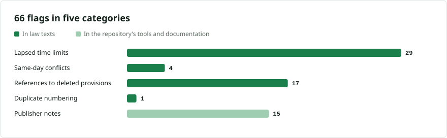

# Vulnerabilities in Peruvian law

[Español](README.md) · **English**

<picture>
<source media="(prefers-color-scheme: dark)" srcset="img/flags-by-category-dark.svg">

</picture>

The vulnerability detectors from [lexifina/global-law](https://github.com/lexifina/global-law/tree/main/vulnerabilities) look for mechanical mistakes in legislation: a rule applying "until" a date that has passed, a time limit extended only after it had run out, a provision repealed before its replacement took effect, an amount changed in one place but not in another, a reference to an article that no longer exists. global-law's published list (9 November 2026) covered Peru with 6 flags from an earlier copy of this repository, all publisher notes (called failed amendments there) and none in law texts: 3 lines of `REPRODUCE.md` and 3 of the repository's tools, working notes that mention the editions' own "(sic)" or "two paragraphs"; its review did not look at them. This is a run over this repository only, as it stood at commit [`aaf40e9`](https://github.com/lexifina/peru-law/commit/aaf40e991158c7aa6d403561e085ea23a11530d7) on 16 November 2026, with its whole history. Four of those 6 flags come up again; the other two were in a script the repository no longer holds.

**In short:** the detectors raised 66 flags, 51 of them in law texts. A language model reviewed 49, arguing each one for and against; 1 survived: Article 417-A of the Criminal Code (provoked insolvency) raises the penalty where the proceedings concern the offences "previstos en los artículos 152° al 153° A" (under Articles 152 to 153-A), and Ley 31146 moved Articles 153 and 153-A to Articles 129-A and 129-B in 2021. Checked by hand, it is lawful: the same law's Second Final Complementary Provision says that every reference to the moved articles is to be read with their new numbers, and the same holds for the other 12 references in the Criminal Code to articles that law moved. Of all the references, read by hand, 4 in the Civil Code, which the model found lawful, look like real oversights, of minor effect: Decreto Legislativo 1384 (2018), which reformed the legal capacity of persons with disabilities, repealed Articles 569, 578 and 580 of the Civil Code, but Articles 549 (item 4), 590, 596 and 597 still refer to them, and no later law has changed them in this repository. The other flags are spent transitional rules, effects of how this repository dates the start of some acts, and misreadings. Later, this will be formalised in Lean, similar to our work on [the US tax code](https://lexifina.com/blog/formalizing-the-us-tax-code) and [US case law](https://lexifina.com/blog/formalizing-all-us-case-law-in-lean).

A flag is a prompt to look, not legal advice, and nothing here has been tested in court.

## Flags by category

| Category | What it looks for | Flags | In law texts | Reviewed | Survived review |
| --- | --- | ---: | ---: | ---: | ---: |
| Lapsed time limits | Text still applying a rule "until" a date that has passed | 29 | 29 | 29 | 0 |
| Same-day conflicts | Two acts amending the same provision on the same day | 4 | 4 | 4 | 0 |
| References to deleted provisions | A provision citing an article that no longer exists | 17 | 17 | 16 | 1 |
| Duplicate numbering | Two divisions with the same number in one act | 1 | 1 | 0 | 0 |
| Publisher notes | Notes in which the publisher flags an error or an amendment it could not carry out | 15 | 0 | 0 | 0 |

"In law texts" counts every file of the acts' folders: the Constitution, the codes, the laws and the decrees (`constitucion/`, `codigo-penal/`, `ley-.../`, `decreto-legislativo-.../` and the others); it does not count each folder's `README.md`, `data/`, `tools/` or the documentation (`README`, `REPRODUCE.md`, `LICENSE`). All 15 publisher notes are outside the law texts. This repository holds 63 acts with 377 versions, and 51 of them start from a consolidated text, so the changes made before their first version are inside it. The detectors that compare versions found no repeal gaps, no dates in force before publication and no empty periods, and the search for stale amounts found nothing either: the fines and thresholds of these acts are set in tax units (unidades impositivas tributarias, UIT), named in 81 files of 20 acts, and a single amount in soles is written in figures (the minimum capital of pension fund administrators, "S/. 500 000,00", Article 14 of the consolidated Private Pension Fund Administration System Law). The search for dead currencies reads the inti and, since this run, the sol de oro, but found nothing: the two amounts in soles oro, "treintiséis mil soles oro" and "cuarentiocho mil soles oro" (thirty-six and forty-eight thousand soles oro, Decreto Ley 19990, twelfth and eighteenth transitional provisions), are written in words. A repealed article disappears from its folder here, leaving no file that says "derogado"; the search for references to repealed placeholders read Article 757 of the Code of Civil Procedure, "Trámite de la apelación sin efecto suspensivo" (procedure for an appeal without suspensive effect), as one, and was corrected (see How it was made), after which it found nothing; nor did the search for dead fines.

*Edge cases: the 17 references and the 4 same-day conflicts, grouped by what they turned out to be, and what the other flags are, in [EDGE-CASES.en.md](EDGE-CASES.en.md).*

## Files

| File | Contents |
| --- | --- |
| [data/flags.csv](data/flags.csv) | Every flag, one row per provision and issue |
| [data/reviewed.csv](data/reviewed.csv) | The 49 flags the model reviewed, with its verdict and reason |
| [data/by_category.csv](data/by_category.csv) | The figures in the table above |
| [tools/](tools/) | The scripts behind this run |

Columns: `category` and `category_es` (the category in English and in Spanish), `detector`, `kind` (`law` or `other`), `path` (the file in this repository), `date` (the date the flag turns on), `reference` (the law or the line concerned), `summary`, `score` (the detector's score, 0 to 1), `review` (`artefact`, `lawful` or `candidate_defect`), `survives_rebuttal`, `review_note` (the model's reason), `url` (the provision at the commit read or, if it was removed earlier, at the last commit that held it).

## How it was made

- **Detectors:** global-law's [vulnerabilities/scripts](https://github.com/lexifina/global-law/tree/main/vulnerabilities/scripts), run on this repository at commit `aaf40e9`. global-law replays this repository only up to an earlier commit, so the history table the detectors read was built from this repository's own commits (the law that made each change, its `In-force` date and its `Kind`; the laws, the decrees, the oldest available versions and ruling STC 918/2021 of the Constitutional Court count as law, and documentation and Lexifina's corrections are left out). The detectors carry the fixes global-law's scripts received in the runs on other national repositories, among them the date forms of Spanish as written in Spain, Colombia, Mexico and El Salvador ("hasta el día 31 de diciembre de 2020", "1o. de enero", "a más tardar el ...") and Paraguay's for publisher notes ("no pudo realizarse" only when an amendment is its subject, which removed the flag on Article 174 of the Code of Civil Procedure, "la defensa que no pudo realizar", the defence the party could not make), and three for Peru: "sin efecto suspensivo" is no longer read as a repeal marker; a reference at the end of a line ("en el caso del artículo 580.") is no longer taken for a heading when a word and "artículo" come before it in the sentence; and the sol de oro counts as a dead currency in Peru.
- **Model review:** gpt-5.4-mini, the 40 strongest flags per category; one pass says whether the flag is real and another argues that it is not. It reviewed 49 of the 50 flags in the categories it looks at; the model service's content filter refused the other one, a reference in Article 181-B of the Criminal Code, which was checked by hand. No flag was an empty period, the category global-law reviews with its own procedure. The model does not review duplicate numbering or publisher notes. global-law's own list used a different model.
- **Hand check:** the 17 references were read in this repository's texts and history and in the laws that repealed or moved the articles cited, as published in El Peruano (Decreto Legislativo 1384 of 4 September 2018 and Ley 31146 of 30 March 2021), with their complementary provisions. The 4 same-day conflicts, the 29 lapsed time limits, the duplicate numbering and the 15 publisher notes were also read.

To report a correction, open an issue with the provision and an official source.

## Licence

The lists and notes are Lexifina's and are dedicated to the public domain under CC0 1.0, like this repository's other own contributions. The legal text quoted is official text of the Republic of Peru as published by the Congreso de la República, the Ministry of Justice and Human Rights and Editora Perú; Article 9 of Decreto Legislativo 822, the Copyright Law, excludes official texts of a legislative, administrative or judicial nature from copyright protection. None of those institutions endorses this repository. See [LICENSE](../LICENSE).
