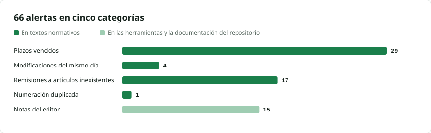

# Vulnerabilidades en el derecho peruano

**Español** · [English](README.en.md)

<picture>
<source media="(prefers-color-scheme: dark)" srcset="img/flags-by-category-dark.es.svg">

</picture>

Los detectores de vulnerabilidades de [lexifina/global-law](https://github.com/lexifina/global-law/tree/main/vulnerabilities) buscan errores mecánicos en la legislación: una regla que sigue aplicándose «hasta» una fecha ya pasada, un plazo prorrogado cuando ya había vencido, una disposición derogada antes de que entrara en vigencia la que la sustituye, un monto modificado en un lugar pero no en otro, una remisión a un artículo que ya no existe. La lista que global-law publicó el 9 de noviembre de 2026 incluía el Perú con 6 alertas, obtenidas de una copia anterior de este repositorio, todas notas del editor (allí llamadas modificaciones fallidas) y ninguna en textos normativos: 3 líneas de `REPRODUCE.md` y 3 de las herramientas del repositorio, notas de trabajo en inglés que mencionan el «(sic)» de las ediciones o «two paragraphs» (dos párrafos); su revisión no las examinó. Esta es una revisión de este repositorio solamente, en el estado del commit [`aaf40e9`](https://github.com/lexifina/peru-law/commit/aaf40e991158c7aa6d403561e085ea23a11530d7) de 16 de noviembre de 2026, con toda su historia. Cuatro de aquellas 6 alertas vuelven a aparecer; las otras dos estaban en un script que el repositorio ya no contiene.

**En resumen:** los detectores generaron 66 alertas, 51 de ellas en textos normativos. Un modelo de lenguaje revisó 49, con argumentos a favor y en contra de cada una; 1 resistió: el artículo 417-A del Código Penal (insolvencia provocada) agrava la pena cuando el proceso es por los delitos «previstos en los artículos 152° al 153° A», y la Ley 31146 trasladó en 2021 los artículos 153 y 153-A a los artículos 129-A y 129-B. Comprobada a mano, es conforme a derecho: la Segunda Disposición Complementaria Final de la misma ley dispone que toda referencia a los artículos reubicados se entienda hecha a su nueva numeración, y lo mismo vale para las otras 12 remisiones del Código Penal a artículos que esa ley trasladó. Leídas a mano todas las remisiones, 4 del Código Civil, que el modelo dio por conformes a derecho, parecen descuidos reales, de efecto menor: el Decreto Legislativo 1384 (2018), que reformó la capacidad jurídica de las personas con discapacidad, derogó los artículos 569, 578 y 580 del Código Civil, pero los artículos 549 (inciso 4), 590, 596 y 597 siguen remitiendo a ellos, y ninguna norma posterior los ha modificado en este repositorio. Las demás alertas son reglas transitorias agotadas, efectos de cómo este repositorio data el inicio de algunas normas y lecturas erróneas. Más adelante se formalizará en Lean, como nuestro trabajo sobre [el código tributario de EE. UU.](https://lexifina.com/blog/formalizing-the-us-tax-code) y [la jurisprudencia de EE. UU.](https://lexifina.com/blog/formalizing-all-us-case-law-in-lean).

Una alerta es una invitación a examinar el texto, no un asesoramiento jurídico, y nada de lo aquí expuesto se ha sometido a un juez.

## Alertas por categoría

| Categoría | Qué busca | Alertas | En textos normativos | Revisadas | Resistieron la revisión |
| --- | --- | ---: | ---: | ---: | ---: |
| Plazos vencidos | Un texto que sigue aplicando una regla «hasta» una fecha ya pasada | 29 | 29 | 29 | 0 |
| Modificaciones del mismo día | Dos normas que modifican la misma disposición el mismo día | 4 | 4 | 4 | 0 |
| Remisiones a disposiciones inexistentes | Una disposición que remite a un artículo que ya no existe | 17 | 17 | 16 | 1 |
| Numeración duplicada | Dos divisiones con el mismo número en una norma | 1 | 1 | 0 | 0 |
| Notas del editor | Notas en las que el editor señala un error o una modificación que no pudo incorporarse | 15 | 0 | 0 | 0 |

«En textos normativos» cuenta todos los archivos de las carpetas de normas: la Constitución, los códigos, las leyes y los decretos (`constitucion/`, `codigo-penal/`, `ley-.../`, `decreto-legislativo-.../` y las demás); no cuenta el `README.md` de cada carpeta, `data/`, `tools/` ni la documentación (`README`, `REPRODUCE.md`, `LICENSE`). Las 15 notas del editor están fuera de los textos normativos. Este repositorio contiene 63 normas con 377 versiones, y 51 de ellas comienzan con un texto consolidado, de modo que los cambios anteriores a su primera versión quedan dentro de esta. Los detectores que comparan versiones no hallaron vacíos tras la derogación, vigencias anteriores a la publicación ni periodos de vacío normativo, y la búsqueda de montos no actualizados tampoco halló nada: las multas y los umbrales de estas normas se fijan en unidades impositivas tributarias (UIT), que mencionan 81 archivos de 20 normas, y un solo monto en soles está escrito en cifras (el capital mínimo de las AFP, «S/. 500 000,00», artículo 14 del Texto Único Ordenado de la Ley del Sistema Privado de Administración de Fondos de Pensiones). La búsqueda de monedas sin curso legal lee el inti y, desde esta revisión, el sol de oro, pero no halló nada: los dos montos en soles oro, «treintiséis mil soles oro» y «cuarentiocho mil soles oro» (Decreto Ley 19990, disposiciones transitorias duodécima y decimoctava), están escritos en letras. Un artículo derogado desaparece aquí de su carpeta, sin dejar un archivo que diga «derogado»; la búsqueda de remisiones a disposiciones derogadas leía como tal el artículo 757 del Código Procesal Civil, «Trámite de la apelación sin efecto suspensivo», y se corrigió (véase «Cómo se hizo»), con lo que no halló nada; tampoco la de sanciones sin conducta tipificada.

*Casos límite: las 17 remisiones y las 4 modificaciones del mismo día, agrupadas según lo que resultaron ser, y qué son las demás alertas, en [EDGE-CASES.md](EDGE-CASES.md).*

## Archivos

| Archivo | Contenido |
| --- | --- |
| [data/flags.csv](data/flags.csv) | Todas las alertas, una fila por disposición y problema |
| [data/reviewed.csv](data/reviewed.csv) | Las 49 alertas que revisó el modelo, con su veredicto y su motivo |
| [data/by_category.csv](data/by_category.csv) | Las cifras de la tabla anterior |
| [tools/](tools/) | Los scripts de esta revisión |

Columnas: `category` y `category_es` (la categoría en inglés y en español), `detector`, `kind` (`law` u `other`), `path` (el archivo en este repositorio), `date` (la fecha de la que depende la alerta), `reference` (la norma o la línea afectada), `summary`, `score` (la puntuación del detector, de 0 a 1), `review` (`artefact`, `lawful` o `candidate_defect`), `survives_rebuttal`, `review_note` (el motivo del modelo, en inglés), `url` (la disposición en el commit leído o, si se suprimió antes, en el último commit que la contenía).

## Cómo se hizo

- **Detectores:** los [vulnerabilities/scripts](https://github.com/lexifina/global-law/tree/main/vulnerabilities/scripts) de global-law, ejecutados sobre este repositorio en el commit `aaf40e9`. global-law reproduce este repositorio solo hasta un commit anterior, por lo que la tabla histórica que leen los detectores se construyó con los propios commits de este repositorio (la norma que hizo cada cambio, su fecha `In-force` y su `Kind`; las leyes, los decretos, las versiones más antiguas disponibles y la sentencia del Tribunal Constitucional 918/2021 cuentan como derecho, y se excluyen la documentación y las correcciones de Lexifina). Los detectores incorporan las correcciones que los scripts de global-law recibieron en las revisiones de otros repositorios nacionales, entre ellas las formas de fecha del español de España, Colombia, México y El Salvador («hasta el día 31 de diciembre de 2020», «1o. de enero», «a más tardar el ...») y la del Paraguay para las notas del editor («no pudo realizarse» solo cuando su sujeto es una modificación, lo que retiró la alerta del artículo 174 del Código Procesal Civil, «la defensa que no pudo realizar»), y tres para el Perú: «sin efecto suspensivo» ya no se lee como marca de derogación; una remisión al final de una línea («en el caso del artículo 580.») ya no se toma por un encabezado cuando una palabra y «artículo» la preceden en la frase; y el sol de oro cuenta como moneda sin curso legal en el Perú.
- **Revisión por el modelo:** gpt-5.4-mini, las 40 alertas más sólidas de cada categoría; una pasada dice si la alerta es real y otra argumenta que no lo es. Revisó 49 de las 50 alertas de las categorías que examina; la restante, una remisión del artículo 181-B del Código Penal, la rechazó el filtro de contenidos del servicio del modelo, y se comprobó a mano. No hubo periodos de vacío normativo, la categoría que global-law revisa con su propio procedimiento. El modelo no revisa la numeración duplicada ni las notas del editor. La lista propia de global-law usó otro modelo.
- **Comprobación manual:** las 17 remisiones se leyeron en los textos y la historia de este repositorio y en las normas que derogaron o trasladaron los artículos citados, tal como se publicaron en El Peruano (el Decreto Legislativo 1384, de 4 de septiembre de 2018, y la Ley 31146, de 30 de marzo de 2021), con sus disposiciones complementarias. Se leyeron también las 4 modificaciones del mismo día, las 29 alertas de plazos vencidos, la de numeración duplicada y las 15 notas del editor.

Para comunicar una corrección, abra una incidencia con la disposición y una fuente oficial.

## Licencia

Las listas y las notas son de Lexifina y se dedican al dominio público con CC0 1.0, como las demás aportaciones propias de este repositorio. El texto jurídico citado es texto oficial de la República del Perú, tal como lo publican el Congreso de la República, el Ministerio de Justicia y Derechos Humanos y Editora Perú; el artículo 9 del Decreto Legislativo 822, Ley sobre el Derecho de Autor, excluye de la protección del derecho de autor los textos oficiales de carácter legislativo, administrativo o judicial. Ninguna de esas instituciones avala este repositorio. Véase [LICENSE](../LICENSE).
